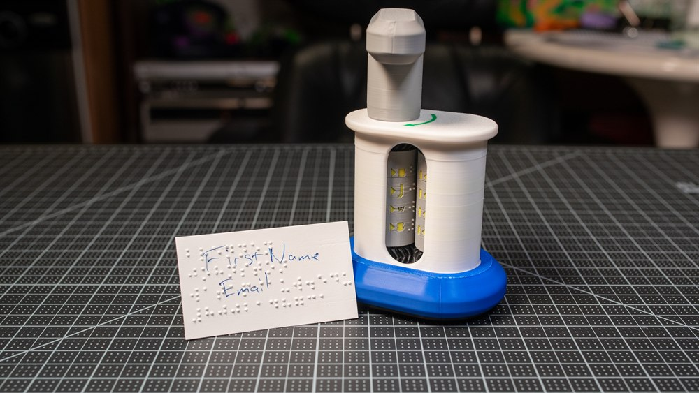

<!--- Open Source Assistive Technology: GitHub Readme based on OpenAT-Template v1.2 (2025-Feb-04). Original template: https://github.com/makersmakingchange/OpenAT-Template --->

# Custom Braille Embosser

## Overview
The Custom Braille Embosser is an open-source assistive technology device that lets a blind or low-vision user (or a sighted helper) hand-emboss permanent, raised, Grade-1 / Grade-2 braille onto card stock and similar paper using fully 3D-printable parts and interchangeable, parametric embossing/counter plates.

The device is comprised entirely of 3D-printed parts. There are **no off-the-shelf electronics, no fasteners, no springs, and no glue**: everything (body, embosser-and-counter plate holders, grip extension, handle assembly) snaps together by hand from ten 3D-printed pieces. The braille content itself is supplied by interchangeable cylindrical embossing and counter plates that are generated from text using one of the companion repositories below.

The Custom Braille Embosser is open assistive technology (OpenAT). Under the terms of the open-source licenses in this repository, the device may be built, used, and improved upon by anyone.

The overall cost of materials is approximately **$3-$6 USD** of 3D-printer filament per device (plus the cost of card stock and the cost of printing the desired braille plates). There are no off-the-shelf electronic components and no shipping cost beyond filament.

## Makers Making Change Assistive Device Library
<MMCWebLink>

> The MMC library URL is assigned by Makers Making Change after submission. Until then, this placeholder is intentionally left in place; the `Update About MMC Section` GitHub Action keeps the boilerplate footer in sync.

## How to Obtain the Device
### 1. Do-it-Yourself (DIY) or Do-it-Together (DIT)

This is an open-source assistive technology, so anyone is free to build it. All of the files and instructions required to build the device are contained within this repository. Refer to the Maker Guide below.

### 2. Request a build of this device

You may also submit a build request through the [Makers Making Change Assistive Device Library Listing](<MMCWebLink>) to have a volunteer maker build the device. As the requestor, you are responsible for reimbursing the maker for the cost of materials and any shipping.

### 3. Build this device for someone else

If you have the skills and equipment to build this device, and would like to donate your time to create the device for someone who needs it, visit the [MMC Maker Wanted](https://makersmakingchange.com/maker-wanted/) section.

## Generating Custom Braille Plates - Two Customizer Options
The Custom Braille Embosser is **plate-driven**: the device itself is content-agnostic. To emboss a particular message you generate a matching pair of cylindrical plates (an *embossing plate* with the raised dots, and a *universal counter plate* with the matching cavities). Two officially supported customizers are available; **most users should start with the web-based customizer**.

### Primary - Web-Based Customizer (recommended for most users)

Open the web app, type your text, choose a translation table, click Generate, and download `.stl` files. The web app handles English -> Grade 1 / Grade 2 braille translation automatically (powered by the open-source [Liblouis](https://liblouis.io/) library, with 50+ language tables) and runs the entire STL generation in your browser - your text is never uploaded to a server.

| Field | Value |
|---|---|
| **Open the web app** | <https://braille-cylinder-stl-generator.vercel.app> |
| Source repository | [`braille-cylinder-stl-generator`](https://github.com/BrennenJohnston/braille-cylinder-stl-generator) |
| Best for | Most users; users who want automatic translation; users who use a screen reader; users on Chromebooks / tablets / no-install workflows |
| Walkthrough | [Video Tutorial 1 (YouTube)](https://youtu.be/m71VNZq28MI) |

### Alternative - OpenSCAD Offline Customizer (included in this repo)

For full parametric control, fully offline workflows, or integration with existing OpenSCAD pipelines, a copy of the OpenSCAD generator is included directly in this repository at [`/Build_Files/3D_Printing_Files/Embossing_Plates_Customizer/OpenSCAD_Offline_Alternative/`](/Build_Files/3D_Printing_Files/Embossing_Plates_Customizer/OpenSCAD_Offline_Alternative). The full side-by-side comparison and quick-start steps live in the customizer folder's [README](/Build_Files/3D_Printing_Files/Embossing_Plates_Customizer/README.md).

| Field | Value |
|---|---|
| **Local copy** | [`Build_Files/3D_Printing_Files/Embossing_Plates_Customizer/OpenSCAD_Offline_Alternative/`](/Build_Files/3D_Printing_Files/Embossing_Plates_Customizer/OpenSCAD_Offline_Alternative) |
| Upstream repository | [`braille-cylinder-stl-generator-openscad`](https://github.com/BrennenJohnston/braille-cylinder-stl-generator-openscad) |
| Vendored version | 2.2.1 (2026-05-30) |
| Best for | Offline use; fully parametric control; batch processing; users with existing OpenSCAD workflows |
| License (this folder only) | PolyForm Noncommercial 1.0.0 - separate from the rest of the repository |
| Required software | [OpenSCAD](https://openscad.org/) 2024.x or newer |

> **Accessibility note:** for an even more screen-reader-friendly browser UI on top of the OpenSCAD generator, see the companion project [`openscad-assistive-forge`](https://github.com/BrennenJohnston/openscad-assistive-forge).

### Pre-generated example plates (verify your printer first)

A pair of pre-generated example plates (`Embossing_Plate_Brennen_0.3.stl`, `Universal_Counter_Plate_0.3.stl`, plus 0.4 mm variants) for 0.3 mm and 0.4 mm card stock are included in [`/Build_Files/3D_Printing_Files/Embossing_Plates_Examples/`](/Build_Files/3D_Printing_Files/Embossing_Plates_Examples) so you can verify your printer and the embosser before generating your own content.

## Build Instructions
### 1. Read through the Maker Guide

The [Maker Guide](/Documentation/Custom_Braille_Embosser_Maker_Guide.pdf) contains all the necessary information to build this device, including tool lists, print settings, assembly instructions, and testing.

### 2. Order the Off-The-Shelf Components

The [Bill of Materials](/Documentation/Custom_Braille_Embosser_BOM.xlsx) lists everything needed for a build. The Custom Braille Embosser has **no off-the-shelf electronic components and no fasteners**; the BOM consists of 3D-printer filament and consumable card stock.

### 3. Print the 3D Printable Components

The 10 part STLs are in [`/Build_Files/3D_Printing_Files/STL`](/Build_Files/3D_Printing_Files/STL). Bambu Lab X1C `.3mf` print profiles (already arranged on the build plate, with supports and material set) are available in [`/Build_Files/3D_Printing_Files/Print_Profiles/X1C`](/Build_Files/3D_Printing_Files/Print_Profiles/X1C), alongside companion markdown notes documenting the slicer settings used for this initial posting.

### 4. Generate (or download) Embossing & Counter Plates

Pick one of the two customizer paths described in [Generating Custom Braille Plates](#generating-custom-braille-plates---two-customizer-options) above:
- **Primary:** the web-based customizer at <https://braille-cylinder-stl-generator.vercel.app> (auto-translates English to braille).
- **Alternative:** the OpenSCAD customizer included in this repo at [`Build_Files/3D_Printing_Files/Embossing_Plates_Customizer/OpenSCAD_Offline_Alternative/`](/Build_Files/3D_Printing_Files/Embossing_Plates_Customizer/OpenSCAD_Offline_Alternative).

Generate both an embossing plate and a matching universal counter plate at the **same** card-stock thickness, then print them on the same printer. (You can also start with the pre-generated example plates in [`/Build_Files/3D_Printing_Files/Embossing_Plates_Examples/`](/Build_Files/3D_Printing_Files/Embossing_Plates_Examples) to verify your printer first.)

### 5. Assemble the Custom Braille Embosser

Reference the Assembly Guide section of the [Maker Guide](/Documentation/Custom_Braille_Embosser_Maker_Guide.pdf), watch the assembly video on YouTube ([Video 2 - Assembling the 3D-printed parts](https://youtu.be/x-uPNtT2Gqk)), or follow the numbered screenshots in [`/Video_Tutorials/Video_2_Screen_Shots/`](/Video_Tutorials/Video_2_Screen_Shots).

## How to Improve this Device
As open-source assistive technology, you are welcomed and encouraged to improve upon the design. Suggested directions documented in the [Design Rationale](/Documentation/Custom_Braille_Embosser_Design_Rationale.pdf) include: thicker-paper handling, multi-line registration, different braille standards (UEB, Marburg Medium, Japanese), and motorized variants.

## Files
### Documentation
| Document             | Version | Link |
|----------------------|---------|------|
| Design Rationale     | 1.0     | [Custom_Braille_Embosser_Design_Rationale](/Documentation/Custom_Braille_Embosser_Design_Rationale.pdf) |
| Maker Guide          | 1.0     | [Custom_Braille_Embosser_Maker_Guide](/Documentation/Custom_Braille_Embosser_Maker_Guide.pdf) |
| Bill of Materials    | 1.0     | [Custom_Braille_Embosser_BOM](/Documentation/Custom_Braille_Embosser_BOM.xlsx) |
| User Guide           | 1.0     | [Custom_Braille_Embosser_User_Guide](/Documentation/Custom_Braille_Embosser_User_Guide.pdf) |
| Quickstart Guide     | 1.0     | [Custom_Braille_Embosser_Quickstart_Guide](/Documentation/Custom_Braille_Embosser_Quickstart_Guide.pdf) |
| Summary              | 1.0     | [Custom_Braille_Embosser_Summary](/Documentation/Custom_Braille_Embosser_Summary.pdf) |
| Changelog            | 1.0     | [Changelog](CHANGES.txt) |

### Design Files
- [CAD Files (Fusion `.f3z`, STEP, OBJ)](/Design_Files/CAD_Design_Files)

### Build Files
- [3D Printing Files (STL + sliced `.3mf` for X1C)](/Build_Files/3D_Printing_Files)
- [Example Embossing & Counter Plates](/Build_Files/3D_Printing_Files/Embossing_Plates_Examples) - 0.3 mm and 0.4 mm pairs to verify your printer
- [Embossing Plates Customizer](/Build_Files/3D_Printing_Files/Embossing_Plates_Customizer) - links to the primary web-based customizer and an offline OpenSCAD copy for generating your own plates

### Video Tutorials
The three step-by-step tutorial videos are **hosted on YouTube**. The recordings are 368-705 MB each, past GitHub's 100 MB per-file limit, so the `.mp4` files themselves are not in this repository. Everything else that goes with them is: subtitles, per-step screenshots, and a written walkthrough.

| # | Topic | YouTube | In this repo |
|---|---|---|---|
| 1 | Customizing braille, downloading STLs, adjusting 3D-print settings | [youtu.be/m71VNZq28MI](https://youtu.be/m71VNZq28MI) | [`.srt` + screenshots](/Video_Tutorials/Video_1_Customizing_Braille_Downloading_STL_3D_Print_Settings) |
| 2 | Assembling the 3D-printed parts | [youtu.be/x-uPNtT2Gqk](https://youtu.be/x-uPNtT2Gqk) | [`.srt`](/Video_Tutorials/Video_2_Assembling_Braille_Embosser_3D_Printed_Parts) + [step-by-step screenshots](/Video_Tutorials/Video_2_Screen_Shots) |
| 3 | Using the completed Custom Braille Embosser | [youtu.be/77iXvJbkXh4](https://youtu.be/77iXvJbkXh4) | [`.srt` + screenshots](/Video_Tutorials/Video_3_How_To_Use_Completed_Braille_Embosser) |

**If you cannot use video** — no internet, screen reader, or you simply prefer text — the full procedure is written out in [`Video_Tutorials/Custom_Braille_Embosser_Written_Tutorial.md`](/Video_Tutorials/Custom_Braille_Embosser_Written_Tutorial.md), derived from the video transcripts, and the assembly is illustrated step by step in [`Video_Tutorials/Video_2_Screen_Shots/`](/Video_Tutorials/Video_2_Screen_Shots). The [Maker Guide](/Documentation/Custom_Braille_Embosser_Maker_Guide.pdf) covers the same ground.

All three videos are indexed - with copy-paste-ready embed snippets for MakerWorld / Printables / blog posts - in [`Video_Tutorials/README.md`](/Video_Tutorials/README.md).

## License
Copyright (c) 2026 Brennen Johnston.

This repository describes Open Hardware:
- Everything needed or used to design, make, test, or prepare the Custom Braille Embosser is licensed under the [CERN 2.0 Weakly Reciprocal license (CERN-OHL-W v2) or later](https://cern.ch/cern-ohl).
- All software is under the [GNU General Public License v3.0 (GPL-3.0)](https://www.gnu.org/licenses/gpl.html).
- Accompanying material such as instruction manuals, videos, and other copyrightable works that are useful but not necessary to design, make, test, or prepare the Custom Braille Embosser are published under a [Creative Commons Attribution-ShareAlike 4.0 license (CC BY-SA 4.0)](https://creativecommons.org/licenses/by-sa/4.0/).
- **Exception:** the vendored copy of the OpenSCAD plate generator at [`Build_Files/3D_Printing_Files/Embossing_Plates_Customizer/OpenSCAD_Offline_Alternative/`](/Build_Files/3D_Printing_Files/Embossing_Plates_Customizer/OpenSCAD_Offline_Alternative) is governed by a separate [PolyForm Noncommercial 1.0.0](https://polyformproject.org/licenses/noncommercial/1.0.0) license (see `LICENSE_PolyForm_Noncommercial_1.0.0.md` in that folder). It is free for personal, educational, and non-commercial use; no commercial use is permitted. The web-based customizer at <https://braille-cylinder-stl-generator.vercel.app> is also licensed under PolyForm Noncommercial 1.0.0.

You may redistribute and modify this documentation and make products using it under the terms of the [CERN-OHL-W v2](https://cern.ch/cern-ohl).
This documentation is distributed WITHOUT ANY EXPRESS OR IMPLIED WARRANTY, INCLUDING OF MERCHANTABILITY, SATISFACTORY QUALITY AND FITNESS FOR A PARTICULAR PURPOSE.
Please see the CERN-OHL-W v2 for applicable conditions.

Source Location: https://github.com/BrennenJohnston/custom-braille-embosser-3d-printing-project

## Attribution
The device was designed by Brennen Johnston.

The cylindrical embossing-plate and counter-plate generator code (used to produce the example plates included in this repository, and vendored into [`Build_Files/3D_Printing_Files/Embossing_Plates_Customizer/OpenSCAD_Offline_Alternative/`](/Build_Files/3D_Printing_Files/Embossing_Plates_Customizer/OpenSCAD_Offline_Alternative)) is from the companion projects [`braille-cylinder-stl-generator-openscad`](https://github.com/BrennenJohnston/braille-cylinder-stl-generator-openscad) and [`braille-cylinder-stl-generator`](https://github.com/BrennenJohnston/braille-cylinder-stl-generator), also by Brennen Johnston. The braille translation in the web app is powered by the open-source [Liblouis](https://liblouis.io/) library.

The documentation template was created by Makers Making Change / Neil Squire Society and is used under a CC BY-SA 4.0 license. It is available at: [https://github.com/makersmakingchange/OpenAT-Template](https://github.com/makersmakingchange/OpenAT-Template)

### Contributors
Designers:
- Brennen Johnston

Testers:
- Brennen Johnston

---
<!-- ABOUT MMC START -->
## About Makers Making Change

Makers Making Change is a program of [Neil Squire](https://www.neilsquire.ca/), a Canadian non-profit that uses technology, knowledge, and passion to empower people with disabilities.

Makers Making Change leverages the capacity of community based Makers, Disability Professionals and Volunteers to develop and deliver affordable Open Source Assistive Technologies.

 - Website: [www.MakersMakingChange.com](https://www.makersmakingchange.com/)
 - GitHub: [makersmakingchange](https://github.com/makersmakingchange)
 - Bluesky: [@makersmakingchange.bsky.social](https://bsky.app/profile/makersmakingchange.bsky.social)
 - Instagram: [@makersmakingchange](https://www.instagram.com/makersmakingchange)
 - Facebook: [makersmakechange](https://www.facebook.com/makersmakechange)
 - LinkedIn: [Neil Squire Society](https://www.linkedin.com/company/neil-squire-society/)
 - Thingiverse: [makersmakingchange](https://www.thingiverse.com/makersmakingchange/about)
 - Printables: [MakersMakingChange](https://www.printables.com/@MakersMakingChange)

### Contact Us
For technical questions, to get involved, or to share your experience we encourage you to [visit our website](https://www.makersmakingchange.com/) or [contact us](https://www.makersmakingchange.com/s/contact).
<!-- ABOUT MMC END -->
